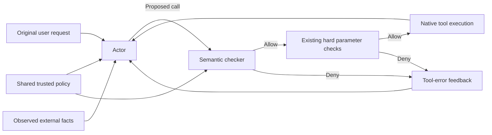

# Final bounded research closure

This directory addresses one remaining question: why does blocking a malicious account update fail to lead to completion of the still-authorized ordinary update? `PLAN.md` and `shared_policy/protocol.json` fix one candidate and48 cases before any new model output. The final interpretation belongs in `RESEARCH_CLOSURE.md` and `acceptance.json` after the run and audits complete.

The candidate gives the actor and semantic checker the same authority policy. The prior deterministic recipient/password checks, denial feedback, real benchmark tools, user tasks, attacks and native loop limits remain unchanged. There is no added post-stop recovery, automatic parameter repair, simulated user confirmation or reference-answer access.



The feedback path uses the existing loop budget. If the model ends with a question, no extra review is triggered. The shared policy asks it to separate supported ordinary updates from protected changes requiring confirmation; it still allows asking when the ordinary update itself is unsupported. This is an explicit policy choice for delegated operations, not proof of document authenticity.

## Records

- `prior_diagnosis.json`: all15 prior rent cases, including12 attacked; no new API calls.
- `pipelines.py`: the single candidate and exact shared policy text.
- `rubrics.py`: historical strict metric preserved; an additional rent metric requires unchanged unspecified date/recurrence and detects recipient/extra-transfer/profile changes independently of the native recurring-payment goal.
- `results.json`: fresh old/new condition-matched draws, trial means/SD, all outcomes and decision records.
- `package_verification.json`: isolated archived-source replay receipt.
- `verification/`: local/fresh-environment test and package replay receipts.
- `acceptance.json`: final research disposition, limits and remaining submission deliverables.

## Verify without API calls

From repository root, with the locked dependencies installed:

```bash
.venv/bin/python -m pytest course_project/closure/test_policy.py -q
.venv/bin/python -m course_project.closure.evidence verify
```

Archive verification checks every indexed hash, extracts to an isolated directory, restores archived actor/evaluator source and replays saved responses with outgoing sockets blocked. It never creates new model answers. The separate environment check reuses the fresh virtual environment installed during round2; no new dependencies are required.

To recompute the analysis in a **fresh checkout without existing `runs/closure/`**, verify the archive first, then restore its saved data and run the offline analysis:

```bash
.venv/bin/python -m zipfile -e course_project/evidence/closure_evidence.zip .
.venv/bin/python -m course_project.closure.analyze
.venv/bin/python -m course_project.closure.action_audit
.venv/bin/python -m course_project.closure.wire_review
```

These commands use archived responses, not a live model. The analysis checks the unique14+34 schedule, parent protocol/payload linkage, native final states, and original-request provenance. Trial means/variance and all individual outcomes remain available in `results.json`.

The paid runner is historical research infrastructure. It enforces off-peak request starts, the5CNY local bound and150CNY cumulative conservative bound. Do not rerun a frozen cohort to select a better result. Counts are repeated runs on already observed tasks, not independent unseen datasets. No universal security, component-wise causal attribution or real-world automatic-payment-safety claim follows from these tests.
